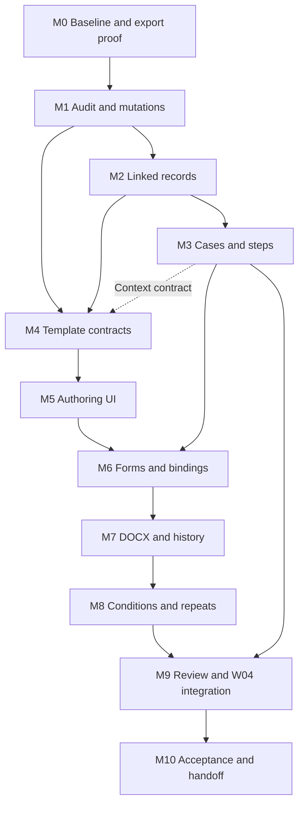

# Resolution builder and linked records: implementation handoff

**Prepared:** 26 October 2026, Asia/Kuala_Lumpur  
**Status:** Proposed implementation plan for a subsequent implementing agent. No features in this plan have been implemented by writing this document.  
**Priority:** Board resolution documents and director appointment/resignation resolution documents.  
**Delivery model:** Incremental changes to the existing local application, preserving its data, approved Option A design and workflow safeguards.

## 1. Start here

The owner spoke with users and narrowed the next delivery priority to two useful outcomes:

1. Prepare board resolution documents.
2. Prepare director appointment and resignation resolution documents.

Users must author templates **inside the application**. A template author writes and formats a document, creates reusable tags, defines where each tag gets its value, and configures questions such as checkboxes, dropdowns and text inputs. A document preparer selects a template, company and related records, answers the remaining questions, previews the result and downloads a genuine `.docx` file.

The owner also requested linked companies, directors/board members, events and their smaller steps, customisation, and audit logs for changes. This plan covers all five foundations previously proposed: linked records; versioned templates and custom questions; document generation; reproducible document history; and searchable before/after auditing.

**First action for the implementing agent:** execute M0 below, reconcile this plan with the actual checkout, then work through the dependency graph. The current conversation authorises this planning document; it does not claim that implementation, purchase of software, deployment or live statutory use has already been approved. When the owner asks the next agent to implement this plan, ordinary local implementation and fictional-data verification can proceed within that request.

### Reading order

1. [AGENTS.md](AGENTS.md): project instructions.
2. [DESIGN.md](DESIGN.md): approved Option A tokens and component behaviour.
3. [DESIGN_SPEC.md](DESIGN_SPEC.md): read Product authority and scope; Staff roles and access; Object relationships; Independent states and time; W04/W07 coverage; Documents and signatures; Settings and editing requirements; failure states; and acceptance scenarios.
4. This document: next delivery scope, proposed contracts and milestones.
5. [docs/CONTRACTS.md](docs/CONTRACTS.md), [docs/SUPPORT_ACTIONS.md](docs/SUPPORT_ACTIONS.md), [docs/WORKFLOW_ACTIONS.md](docs/WORKFLOW_ACTIONS.md): existing implementation contracts.
6. [docs/VERIFICATION.md](docs/VERIFICATION.md), [docs/RECOVERY.md](docs/RECOVERY.md), [docs/LOCAL_SETUP.md](docs/LOCAL_SETUP.md): existing evidence and operating limits.

The owner's new scope changes delivery priority. It does not erase the broader W01–W12 backlog or permit weakening existing statutory, access, evidence or historical-record contracts. If the new document-first path changes a documented workflow, record the specific change in DESIGN_SPEC.md during implementation. Retain the original brief and prototype.

### Milestone tracker

All statuses below are **Planned**, not delivered.

| ID | Milestone | Depends on | Observable outcome |
| --- | --- | --- | --- |
| M0 | Baseline, contracts and document feasibility | — | Existing state recorded; risks and export approach demonstrated |
| M1 | Audit and mutation foundations | M0 | New changes have transactional, scoped before/after audit |
| M2 | Companies, people and dated relationships | M1 | One person can participate in multiple authorised companies |
| M3 | Resolution cases and steps | M2 | A board-resolution case or W04-linked case has owned work and explicit dates |
| M4 | Structured templates and field definitions | M1, M2; context contracts from M3 | Versioned templates contain validated fields and document structure |
| M5 | In-app template authoring | M4 | User creates document content and custom input tags in the browser |
| M6 | Generated forms and value resolution | M3, M4, M5 | Known values fill automatically; remaining inputs form a validated form |
| M7 | DOCX generation and saved history | M6; renderer proved in M0 | A complete first slice generates, stores and downloads Word documents |
| M8 | Conditions, repeats and practical layout | M7 | Optional clauses, multiple signatories and multi-page output work |
| M9 | Review, director-change integration and consequences | M3, M7, M8 | Both priority use cases work with exact-version review and existing W04 safeguards |
| M10 | Hardening, user acceptance and handoff | M1–M9 | Verified feature, migration/recovery evidence and usable documentation |

**First usable slice:** M0–M7, using simple board and appointment/resignation drafts. **Complete requested milestone:** M0–M10. A draft download at M7 is not completion of the whole plan.

## 2. Current application: verified baseline and gaps

This assessment comes from source inspection on 26 October 2026. Existing verification records describe earlier passing checks; the planning pass did not rerun the full suite.

| Area | Present implementation | Reuse / gap |
| --- | --- | --- |
| Stack | Next.js App Router, strict TypeScript, React, Tiptap, Zod, Drizzle, MySQL | Extend the modular monolith; a new service stack is unnecessary |
| Companies | Fixed company data, scope enforcement, opening review, linked jobs and documents | Reuse identity and permissions; add controlled editable particulars/history and custom fields |
| People | IDs and names embedded in jobs/officer events | Add reusable person records and dated company relationships |
| Director work | W04 appointment, resignation, removal and other cessation, evidence, packs, review and posting | Integrate new resolution documents; preserve existing event semantics |
| Cases | W03–W06 fixed job types, correspondence, checklists, histories and filing attempts | Add a bounded resolution-case model and typed steps; avoid a general workflow engine |
| Board resolutions | W07 specified but not implemented | Deliver document preparation and evidence-backed decision tracking; full meeting management stays later |
| Templates | Settings catalogue stores versioned basic HTML with independent publication | Keep existing catalogue working; add a separate structured resolution-template contract |
| Fields | Nine fixed placeholders; director name is not one of them | Add author-defined questions and allowlisted record bindings |
| Editor | Basic paragraphs, emphasis, lists and undo/redo | Keep notes editor small; build a separate template editor |
| Output | Illustrative `.txt` with source snapshot and hash | Add native DOCX rendering and independent generation history |
| Uploads | PDF, PNG, JPEG and TXT; no DOCX | Generated DOCX needs private storage/download support; arbitrary Word upload is outside this scope |
| Audit | Dedicated audit table; transactional application actions; job history | Extend field changes, generation provenance and scoped search/export; not a claim of DB-level auditing |

### Relevant code seams

- Domain: `src/domain/model.ts`, `workflows.ts`, `access.ts`, `records.ts`.
- Persistence/access: `src/server/schema.ts`, `repository.ts`, `auth.ts`, `http.ts`, `record-store.ts`.
- Job actions: `src/server/job-actions/`, `pack-versions.ts`, `record-actions.ts`.
- Existing templates/output: `src/server/support.ts`, `storage.ts`, `src/app/api/documents/generate/route.ts`.
- UI: `src/components/rich-editor.tsx`, `forms.tsx`, `workspace.tsx`, job sections, company pages and Settings.
- Tests: `tests/` and `tests/e2e/`; migrations in `migrations/`.

At planning time, uncommitted changes existed in verification docs, company/document pages, edit protection, workspace, workflow readiness/review actions and tests. Treat the actual `git status` at implementation start as authoritative. Preserve unrelated changes; do not reset the checkout, overwrite these fixes or commit somebody else's work accidentally.

## 3. Product boundaries and delivery tiers

### Required by completion of M10

- Reusable people records and dated company/director relationships.
- Company, person and case custom fields with typed, versioned definitions.
- General board-resolution preparation and director appointment/resignation preparation.
- In-app document authoring with field insertion, field configuration and preview.
- Text, multiline text, date, number, boolean, single-choice, multi-choice and record-selection questions.
- Database bindings, conditions and repeating content, including signatory blocks.
- Document styles, tables, numbering, explicit page breaks, page settings and basic headers/footers.
- Private DOCX generation, immutable versions, repeatable downloads and source provenance.
- Independent template publication and exact-document review consistent with existing policy.
- Application-level audit for new persisted changes, plus scoped audit search and export.
- Existing W03–W06 behaviour preserved and compatibility migrations verified.

### Later scope, retained explicitly

- Full W07 meeting notices, attendance, quorum/vote calculation and procedural automation.
- Configurable legal-rule engines or unrestricted user-built workflow state machines.
- DOCX template upload, lossless import, external Word edit round-tripping and tracked changes.
- Live collaborative editing, comments/mentions and presence.
- Electronic signatures, automatic messages and regulator integrations.
- AI-written clauses or automated legal advice.
- Arbitrary SQL/API bindings, executable formulas or template scripts.
- Complex Word features beyond the agreed export matrix: floating objects, text boxes, intricate section layouts, macros, embedded objects and arbitrary field codes.
- Spreadsheet imports until real source files and mapping requirements are inspected.
- Shared production deployment and live legal approval, which retain their existing release gates.

"Flexible" means authors can assemble the supported building blocks and define new inputs without code. It does not mean every Microsoft Word feature is promised. Name unsupported structures at authoring/publication time; never silently drop them during export.

## 4. User journeys to deliver

### A. Create and publish a template

1. Open Templates from the Documents area or its approved administration link.
2. Create a template; choose board resolution, director appointment or director resignation as its usage context. Start blank or copy an existing draft/version.
3. Write and format content in the app.
4. Insert an existing field or create a new field. Configure label, value type, source, input control, validation and output format.
5. Reuse the same field in several positions without asking the question repeatedly.
6. Add optional clauses, signatory repeats and layout settings as needed.
7. Preview with clearly fictional data and inspect the DOCX preview artifact.
8. Save a draft; ask a different authorised user to review and publish that exact version.
9. Later edits create a successor version. Existing generated documents retain their prior template.

### B. Generate a board-resolution document

1. Choose the company and create/open a resolution case.
2. Choose a published, effective, compatible template.
3. Select related people and the relevant date/context.
4. See record-sourced values and answer only the remaining questions.
5. Validate the form and preview the resolved document.
6. Generate a DOCX draft. The application saves its exact source snapshot, answers, template version and bytes.
7. Review, revise, issue and record external execution separately as applicable.
8. Record the actual decision/evidence and complete only the tasks whose completion rules are satisfied.

### C. Generate an appointment/resignation resolution

1. Open an existing W04 case or start the guided director-change flow.
2. Select an existing person, or create a person through an authorised record action.
3. Select the appointment/resignation context and enter proposed dates/basis.
4. Generate the resolution through the same template/form/output engine.
5. Attach the exact generation to a pack version and request its review.
6. Record required signatures and source evidence through the existing workflow.
7. Post the separately reviewed dated record through W04; record any filing separately.

A resignation template records the selected route and evidence. The application must not imply that a generated resolution itself establishes the resignation's legal effectiveness.

### D. Correct information after generation

1. A company address, person name, event date or template changes.
2. Existing output bytes and approvals remain attached to their original versions.
3. The user sees an available newer source or a material change requiring reassessment.
4. An explicit revise/regenerate command creates a new document version and preserves predecessor links.
5. Review of the previous document is not inherited by the new document.

## 5. Domain vocabulary and proposed data contracts

These are proposed contracts to finalise in M0. Use stable IDs for every reference; labels are editable presentation values. This section is the vocabulary authority for this plan, not a claim that these tables already exist.

### Records and relationships

| Concept | Meaning and required data |
| --- | --- |
| Company | Existing company identity, controlled particulars, verification, revision and dated changes |
| Person | Stable reusable identity; name and minimal needed contact/particulars; revision and source history |
| Company relationship | Person + company + role/capacity + effective interval + source event/evidence; supports more than one company per person |
| Corporate event | A dated proposed/approved/effective change to records; reuses officer-event semantics for director changes |
| Resolution case | Owned preparation work for a board resolution, optionally linked to a W04 job; holds document families, steps and evidence |
| Case step | A smaller owned task such as instruction received, preparation, review, execution or registration evidence; explicit dependencies and dates |
| Custom field definition | Typed additional company/person/case attribute, versioned and access-classified |
| Custom field value | Value tied to a record and definition version, with effective/recorded dates where applicable |

"Event" must not conflate a corporate change, a case step and an audit entry. The user's "micro-events" are represented as case steps or actual dated corporate events according to their meaning. Registration/submission is a recorded external action, not proof that an appointment has taken legal effect.

Company relationships should distinguish executive/nonexecutive or other board capacities only as configured attributes where needed. A generic board role does not automatically become a statutory officer appointment. Derive statutory director membership from the existing approved event rules, with an explicit link between the event and relationship projection.

### Templates and document generations

| Concept | Minimum proposed contract |
| --- | --- |
| Template | Stable ID, name, usage contexts, description, archive state and ownership |
| Template version | Template ID, version, draft revision, schema version, structured body, field definitions, layout/styles, assets, source/basis, effective date, author, reviewer and publication status |
| Template field | Stable field ID, label, value type, source, input UI, validation, formatting and optional repeat scope |
| Document family | Stable ID grouping generations/revisions of one intended resolution |
| Generation | Family ID, predecessor, template version, case/job/company IDs, source snapshot, answers, resolved document, renderer version, hash, storage reference, author and time |
| Document review | Exact generation ID + content hash, scope, decision, reason, reviewer and timestamp |
| Execution evidence | Exact document generation/version, signer identity/capacity, signed date and evidence IDs |

Published versions and generated artifacts are immutable. Drafts have optimistic revision checks. Use explicit successor versions for content changes. Archiving removes a template from new selection while preserving historical access.

Suggested dedicated persistence: `people`, `person_particular_versions`, `company_relationships`, `record_field_definitions`, `record_field_values`, `resolution_cases`, `case_steps`, `resolution_templates`, `resolution_template_versions`, `document_families`, `document_generations`, `document_reviews`, plus existing private-document metadata and audit tables. Consolidating small supporting records into typed JSON is acceptable when transaction/query/access needs are met; IDs, scope, revision and indexes must remain explicit. Avoid a generic entity-attribute-value framework for canonical company identity or officer events.

### Field value sources

Every field has exactly one primary source:

1. **Bound:** allowlisted company/person/relationship/event/case/custom-record attribute.
2. **Question:** an answer entered when the template is used.
3. **Constant:** author-defined fixed value, normally better expressed as text.
4. **Derived:** a small allowlisted formatter/transformation such as formatting a date or joining names. Add only where a real template needs it.

Record selection and property binding are distinct. A `selected_director` question selects a scoped person/relationship; another field can bind to that selection's name. A signatories selection returns an ordered collection of identity/capacity snapshots that a repeat block can iterate.

Bound values are read-only in the generation form by default. Correct source records through their authorised edit route. If an override is needed, require an explicit override permission/reason and preserve both source and chosen value; never write a document answer back into master records implicitly.

### Example field definitions

Illustrative JSON only; settle the actual discriminated union and Zod schema in M0/M4.

```json
[
  {
    "id": "f_company_name",
    "label": "Company name",
    "valueType": "text",
    "source": { "kind": "binding", "path": "company.name" },
    "required": true
  },
  {
    "id": "f_director",
    "label": "Director",
    "valueType": "recordReference",
    "source": { "kind": "question" },
    "input": { "control": "recordSelect", "recordType": "person", "multiple": false },
    "required": true
  },
  {
    "id": "f_director_name",
    "label": "Director name",
    "valueType": "text",
    "source": { "kind": "binding", "path": "selection.f_director.name" },
    "required": true
  },
  {
    "id": "f_include_authority_clause",
    "label": "Include the additional authority clause",
    "valueType": "boolean",
    "source": { "kind": "question" },
    "input": { "control": "checkbox", "defaultValue": false }
  }
]
```

Field IDs belong to a template lineage and are preserved when copying a version. Copying a whole template creates a separate lineage and remaps internal references consistently. Choice options also have stable IDs; changing displayed wording must not silently change historical answers.

### Structured document model

Store validated, schema-versioned JSON as the template source. Suggested nodes:

- Paragraph, heading, text and supported inline marks.
- Inline field reference by ID.
- Ordered/bullet list with explicit list identity and numbering rules.
- Table, row and cell with supported widths/alignment.
- Conditional block with a declarative predicate.
- Repeat block over a bounded collection, containing scoped field references.
- Signature block composed from supported elements and selected people/capacities.
- Explicit page break; layout and header/footer content kept in document settings.

Editor JSON should compile into a renderer-neutral resolved document model. The browser preview and DOCX exporter consume that same resolved model. A node view's screen markup is not the DOCX source. Never perform token replacement on arbitrary HTML and call that equivalent structured export.

Unknown nodes, invalid references, source incompatibility, unsupported formatting and schema versions fail with a useful location. Older schema versions retain a reader/migrator; fail safely rather than mutating published historical content in place.

## 6. Technical architecture and invariants

### Proposed module boundaries

| Module | Responsibility |
| --- | --- |
| People/relationships | Scoped person identity, dated particulars, company associations and migration mappings |
| Resolution cases | Case creation, steps, dependencies and links to existing jobs/events |
| Template definitions | Versioned schema, fields, layout, validation and publication |
| Template editor | Authoring UI, custom nodes, inspector, keyboard operations and draft save |
| Binding/form engine | Field dependencies, scoped source selection, validation and snapshot construction |
| Document compiler | Template + resolved values → validated resolved document model |
| DOCX renderer | Resolved model → native DOCX bytes without fetching external content |
| Generation service | Atomic reservation/finalisation, provenance, private storage and family history |
| Review/execution adapter | Exact generation-to-pack linkage and review/signature invalidation |
| Audit query service | Scoped queries, safe before/after display and controlled export |

Keep orchestration out of React components. Authorisation and validation run on the server for every mutation, preview, record lookup and generation. Prefer focused modules under `src/domain/`, `src/server/` and `src/components/`; final paths should follow repository conventions rather than a compulsory folder rewrite.

### Suggested implementation tools

Extend the existing Tiptap/ProseMirror integration with custom field/condition/repeat nodes. Use a separate editor from notes. Tiptap documents interactive custom node views; those are a useful fit for selectable field chips and configuration panels. [Official node-view documentation](https://tiptap.dev/docs/editor/extensions/custom-extensions/node-views).

Evaluate the TypeScript `docx` library for server-side native Word generation. Its documented document model includes styles, numbering, headers/footers and sections. This is a candidate, not a promise of exact browser-to-Word pagination. [Official library documentation](https://docx.js.org/), [document API](https://docx.js.org/api/classes/index.File.html).

M0 must prove the required output features, package compatibility, licence and local runtime behaviour before implementation commits to a renderer. Check installed/current documentation then. Avoid paid editor/export modules without recording the need and obtaining purchase authorisation. Do not make a cloud service a runtime requirement for this local-first milestone.

### Record binding and validation

- Maintain a registry of allowed paths with type, supported contexts, cardinality, scope and sensitivity.
- Never accept arbitrary property traversal, query text, URLs or server file paths from template authors.
- Check record IDs against both company access and their valid relationship/context. Existing-company directors and proposed new appointees need different selectors.
- A shared person's directory entry must not reveal their other inaccessible companies. An unrelated person must not become discoverable merely because a selector accepts people IDs.
- Exclude BO and other restricted records from general resolution bindings and exports. Add a dedicated authorisation design before expanding that boundary.
- Preserve date-only values; display audit timestamps in Asia/Kuala_Lumpur while storing UTC.
- Treat company registration numbers and identity-like values as strings. Use exact decimal representations for any money/quantities; no unbounded floating-point financial fields.
- Distinguish false, zero, empty, unknown and not applicable. Required booleans test presence, not truthiness; "must be checked" is a separate validation.
- Evaluate dependencies as a bounded directed acyclic graph. Reject cycles, invalid operators and mismatched types.
- Hidden conditional questions are required only while their condition applies. Exclude inactive answers from rendered content while retaining any saved draft history under access policy.
- Reject incomplete required values before final generation. An authoring sample may show labelled placeholders but must not masquerade as a complete resolution.
- Rendering a document has no side effects on source records, corporate events, filing readiness or signature state.

### Publication and change control

Template draft → review → published → archived for new use. Preserve existing independent publication policy: creator cannot publish their own version. A returned review keeps its reason and draft data. Published versions are selected by explicit ID and effective date, not a floating "latest" pointer.

Change field type/options, bindings, conditions, wording or layout through a new version. The publisher sees a diff and affected future/open work; existing generations remain pinned. Template publication is internal content review, not legal certification. Sample templates remain clearly fictional until real wording and sources are approved.

Generated draft → exact-version review → issue/execution evidence as applicable. Use existing canonical document states where possible. A new generation invalidates downstream approvals for that new version. Never relabel the previous generated document as reviewed because its template was published.

### Consistent snapshots and file finalisation

Generation needs a frozen source snapshot, not independent reads that may span a concurrent edit. Propose this sequence:

1. Authorise the request and resolve the template version and selected records under a consistent transaction/ordered-lock strategy.
2. Check draft/case/source revisions; freeze template reference, inputs, relevant as-at records, answer/record provenance, locale, date formatting and renderer settings.
3. Reserve a generation ID with an actor/operation-scoped idempotency key and a pending state; commit the immutable snapshot.
4. Render from that snapshot outside a long database lock. Write bytes to a private temporary/new unique object, compute hash and validate the output package.
5. Finalise artifact metadata and generation state in a transaction with audit; if linked to a job/pack, recheck the expected job revision. A stale link can fail without mutating the pack or deleting a valid standalone draft.
6. Expose only ready, authorised artifacts. Failures are visible and safely retryable; clean up orphan temporary files through bounded reconciliation.

An alternative simpler synchronous implementation is acceptable if it proves equivalent failure behaviour without holding locks through expensive rendering. File writes and database commits are not a single atomic operation; document the reconciliation strategy. Same request key + same payload returns the original generation; reuse with a different payload is a conflict. Record the request hash. Repeated download returns stored bytes; regenerating is explicit and creates a new generation.

Each generation retains the template ID/version/hash, template schema version, source record IDs/revisions/as-at context, selected relationships, field-definition versions, explicit answers, resolved values, resolved document, source snapshot hash, renderer version/settings, author/time, predecessor and artifact hash. Avoid copying entire company/BO/job aggregates into a generally accessible file; snapshot only authorised fields actually needed for provenance. Keep machine provenance private metadata rather than appending JSON to the user's resolution.

### Private DOCX storage

Add a trusted server-generated DOCX storage path with the correct MIME type and attachment filename. Extend the document model and safe-path validation deliberately; generated DOCX support does not automatically enable arbitrary DOCX uploads. Retain immutable bytes, hash integrity checks, company-scoped downloads and audit. No public storage URLs, remote asset fetches or externally linked images. If optional images are supported, validate size/content and store them privately.

### Audit scope

For each successful persisted business change, capture actor, UTC time, company/sensitivity scope, entity/version, action, reason when applicable, request/correlation ID, and typed before/after values or an appropriate structured change set. For person updates, preserve scope at the time of change; current relationships must not retroactively disclose old audit entries.

Audit creation, edits, relationship changes, case-step transitions, template edits/publication/archive, generation success/failure, record overrides, reviews, execution evidence, permission changes and downloads/exports. Unsuccessful attempts can use a distinct security/operational log; avoid pretending an attempted change was committed. Link records rather than duplicating large document binaries or secrets in audit detail. Template draft saves can log structured revision diffs; keystrokes need not become separate audit entries.

New business writes and their audit entries commit together. Existing application mutation coverage must be inventoried and closed where this milestone touches it. Direct database administrator edits are outside application audit guarantees; comprehensive DBA audit requires separate database/operational tooling. Application append-only behaviour is not cryptographic tamper-proofing.

## 7. Milestones and completion gates

### M0 — Baseline, contracts and renderer feasibility

**Work**

- Inspect actual branch/status, instructions, existing schema, running services and tests. Record current unrelated local changes.
- Run appropriate baseline checks and classify pre-existing failures without modifying data destructively.
- Capture the owner's two priority journeys and obtain representative resolution layouts when available. Continue with labelled fictional examples while real content is unavailable.
- Finalise the supported editor/export matrix and initial field types. Record architectural decisions and known limits.
- Spike a native DOCX containing long company/director names, numbered clauses, a table/signature area, headers/footers and a page break.
- Establish the preview/render-and-inspect workflow; use the document-authoring skill/tooling available to the implementing agent where appropriate.

**Done when** baseline evidence exists, the spike opens/renders as Word content with acceptable layout, contracts and migration strategy are written, and any paid/runtime dependency decision is explicit. If actual Word compatibility cannot be tested, mark that acceptance item pending rather than claiming it passed.

### M1 — Audit and mutation foundations

**Work**

- Add a shared audit change contract and before/after formatting with sensitivity controls.
- Reuse revision checks, idempotency, transactions and lock conventions; specify deterministic lock order for multi-company/person updates.
- Build paginated scoped audit queries and a minimal list/detail view with actor/date/company/entity/action filters.
- Inventory current audit coverage and update the touched legacy mutation routes; record genuinely uncovered external/DB operations.
- Introduce capability separation where needed: proposed `manage_people`, `manage_templates`, `generate_documents`, `view_audit`, `export_audit`. Map existing capabilities explicitly; do not silently grant everyone new access.

**Done when** creation/edit/rollback/stale-write/idempotency cases produce correct audit, permission filters cover counts/detail/export, and sensitive person/restricted data cannot leak through audit values. Export is a controlled action; escaping spreadsheet-formula cells is required for CSV output.

### M2 — Companies, people and dated relationships

**Work**

- Add reusable minimal person profiles, controlled edits, verification/source history, company relationships and as-at views.
- Add company-particular changes with revision/history rather than mutating immutable opening/anniversary records.
- Add typed custom field definitions/values for company, person and case scopes; at minimum text, date, number, boolean and choices. Defer more exotic types explicitly.
- Distinguish firm-level identity from company-visible relationships and historical particulars. A company-scoped user cannot alter shared identity in a way that silently changes other companies' prepared outputs.
- Migrate legacy person references without guessing that matching names imply the same person. Preserve IDs where identity is reliable; record ambiguous matches for review.
- Link officer-event projections to relationships without creating two independently editable director registers.

**Done when** one person can be reused across three companies without leaking inaccessible associations, appointment/resignation dates produce correct as-at directors, name corrections preserve historical document values, and migration reruns are safe and auditable. Existing W03 snapshots and W04 job IDs remain valid.

### M3 — Resolution cases and smaller steps

**Work**

- Implement bounded board-resolution cases with company, title, owner, route/context, dates, evidence, documents and optional W04 linkage.
- Add typed owned case steps with dependencies and states such as pending, in progress, waiting, complete and not applicable with reason.
- Support instruction, preparation, review, circulation/execution and external registration/filing evidence steps where applicable.
- Define cancellation/correction consequences and reminder adapters; retain independent job, document, event and filing states.
- Decide whether resolution cases are separate linked records or a deliberate W07 job extension; avoid adding W07 to one union while forgetting every dispatcher, filter and completion evaluator.

**Done when** a general board-resolution case can be prepared without a fictitious director change or automatic statutory filing, a W04 case links to its own steps/documents, dependency cycles are rejected, and completing an operational step cannot bypass record-posting review or unresolved filing tasks.

### M4 — Template schema, fields and lifecycle

**Work**

- Implement template/version storage and the structured document schema, field unions, binding registry, question validation and limits.
- Implement draft save/revision, copy, preview validation, independent publication and archive.
- Add field rename/reuse/deletion rules and schema-version handling.
- Keep legacy catalogue templates and existing illustrative generation compatible. Provide explicit conversion/copy into a new draft only where content can be represented; report unsupported markup.
- Validate that every referenced field exists, bound paths fit the template context, required values can be supplied, and field/condition dependencies are sound.

**Done when** valid templates round-trip without loss, invalid or unsupported structures fail with a useful location, field rename preserves references, delete/type changes expose impact, published bytes/schema stay immutable, and stale edits/self-publication are rejected.

### M5 — In-app authoring experience

**Work**

- Add a template library and separate template editor following DESIGN.md.
- Provide a document canvas, restrained formatting toolbar, insert-field control and contextual field/settings inspector.
- Support creating a question at the point of insertion and reusing it elsewhere; offer existing field search.
- Implement baseline formatting: paragraphs/headings, bold/italic/underline where supported, alignment, lists, indentation, tables and page settings needed by the sample resolutions.
- Provide draft save status, undo/redo, safe paste, validation navigation, sample preview and discard protection.
- Keep long forms and field inspector keyboard reachable; adapt to tablet/mobile with disclosed panels rather than a permanently tiny canvas.

**Done when** a user builds a board-resolution draft entirely in the browser, inserts one bound company name and two custom questions, reuses one question twice, saves/reopens without loss and reaches publication review. Verify keyboard operation, reduced motion, larger text and interrupted navigation.

### M6 — Form generation and record resolution

**Work**

- Render template-defined questions using shared accessible form components.
- Support searchable scoped record selectors, booleans, single/multi-choice, text/multiline, dates and exact numbers with validation.
- Fill bound values and show their source/as-at context on demand. Define default handling, display formatting and ordered selections.
- Save answer drafts against an exact template version and revision; define explicit migration when switching versions instead of silently reusing incompatible answers.
- Resolve source data consistently and report stale/ceased/incompatible selections with retained user input.

**Done when** the owner's two-question example asks exactly two questions, repeating a tag does not duplicate the question, false/zero values survive, guessed unauthorised IDs fail server-side, and invalid selections/missing values produce actionable errors without losing answers.

### M7 — Native DOCX and immutable generation history

**Work**

- Implement the compiler and native DOCX renderer for the agreed baseline node set.
- Implement snapshot reservation, bounded rendering, private file finalisation, retry/idempotency and cleanup.
- Add preview/generate/download endpoints and document-family history with template/source metadata.
- Keep internal metadata separate from clean resolution text; label fictional/draft examples appropriately.
- Verify output integrity and actual layout, not just a `.docx` filename or ZIP signature.

**Done when** a user can create a template in-app, publish it independently, select a company, answer custom questions and download an editable Word file; the same stored document can be downloaded later; source/template changes leave it unchanged; failure/retry/stale-link scenarios do not create duplicate pack attachments or false-ready documents. This is the first usable document-generation slice.

### M8 — Conditions, repeating signatories and practical layout

**Work**

- Add authorable declarative conditional blocks and visibility rules, with dependency/type validation.
- Add bounded repeats over signatory selections and other permitted collections, including ordering and empty-list rules.
- Add repeating signature rows/blocks, basic headers/footers, page numbers, supported page breaks, table widths and paragraph keep rules.
- Include company/person/case custom fields in safe binding selection with definition versions pinned in snapshots.
- Define limits on nodes, nesting, repeat length, asset size, total output and generation time. Reject unbounded work with useful errors.

**Done when** a checkbox adds/removes a whole clause without stray text, selecting three signatories yields exactly three correct signature blocks, repeated record properties resolve within their own item scope, long names and multi-page content remain usable, and invalid cycles/oversized output fail safely.

### M9 — Review and director-change integration

**Work**

- Add fictional starter templates for general board resolution, appointment resolution and resignation resolution. Their wording is evaluation content, not an approved legal precedent.
- Link a generation to an exact W04 pack version and preserve proposal/person/date snapshots.
- Make later director/date/content revisions create a new document/pack version and trigger required independent review.
- Record issued/signed copies and signer capacities against the exact generation. Keep signed attachments separate from generated draft bytes.
- Reuse existing W04 posting and consequence services, including future effectiveness and annual-snapshot safeguards.
- Add evidence-backed general decision tracking without implementing unapproved quorum or statutory decision rules.

**Done when** both appointment and resignation run from person/company selection through document preparation, exact-version review and evidence-backed record posting; future dates behave correctly; filing remains separate; partly signed documents stay partly signed; and a general board document does not claim a decision passed merely because it was generated or downloaded.

### M10 — Hardening, acceptance and handoff

**Work**

- Run the test matrix below, render/inspect representative DOCX output, and complete responsive/accessibility checks.
- Rehearse additive migration and coordinated backup/restore with database, template assets and generated documents together.
- Review scoped selection/audit/export/download behaviour, resource limits and error recovery.
- Walk through both priority journeys with users. Record missing real wording/layouts as acceptance gaps rather than inventing approval.
- Update README, applicable design-spec sections, contracts, local setup, recovery guidance and actual verification evidence.
- Record remaining legal/live-use gates and retained backlog. Keep original brief/prototype intact.

**Done when** every required acceptance row has evidence or an explicitly owner-accepted deferral, production build and relevant regressions pass, recovery restores document hashes/links, and the owner can operate both resolution journeys from the handoff instructions. Unapproved legal content blocks live use even if technical acceptance succeeds.

## 8. Dependency graph and orchestration



Implement vertical paths rather than completing every backend table before any user can generate a document. After contracts are settled, UI and backend can advance together with narrow, reviewable changes. Prove the renderer early; do not postpone Word fidelity to the final week.

### Handoff and coordination protocol

This document is suitable for a single implementing agent or an orchestrator. Delegation is optional and subject to that agent's tool/session instructions. The plan itself does not start agents or authorise messages to unrelated tasks.

If parallel work is authorised, suggested ownership is:

| Lane | Responsibility | Coordination boundary |
| --- | --- | --- |
| Coordinator | Schema/migrations, shared types, API contracts, auth, capability mapping and integration | One owner merges shared contract changes |
| Records/cases | People, relationships, custom record values, case services and domain tests | Uses agreed schema and transaction contracts |
| Template/output | Template validation, compiler, renderer, snapshots and generation tests | Uses fixed node/field contracts |
| UI | Template editor, generated forms, library/history/audit interfaces and browser tests | Consumes versioned DTOs; does not invent server rules |

Use branch/worktree/file ownership according to the active agent instructions. Avoid concurrent edits to shared schema, type unions, package files or central router/workspace. Communicate contract changes before dependent implementation. Never bypass a failing permission gate merely to integrate a UI demo.

### Per-milestone execution loop

1. Read the milestone and dependencies; inspect current code and local changes.
2. Record intended files, contracts and acceptance cases.
3. Implement a coherent vertical change with additive migrations where possible.
4. Run focused domain/database/browser/output checks for that change.
5. Review correctness, permissions, history/concurrency, UX and operational failure paths. Follow applicable review skills/instructions; do not merge with unresolved material findings.
6. Update a milestone ledger with evidence paths, checks, changed assumptions and remaining gaps.
7. Advance only when the milestone gate is satisfied; explain any accepted scope change explicitly.

A suggested ledger is `docs/RESOLUTION_BUILDER_PROGRESS.md`, created when implementation begins. Give each milestone a status, evidence links, migration IDs, test results and next action. Do not mark complete because a screen renders, a mock API works or a file has the right extension.

## 9. Proposed API and access contracts

Endpoint names are proposals. Preserve existing routes and error conventions; finalise DTOs before distributing work.

| Operation | Suggested interface |
| --- | --- |
| Scoped people search/create | `GET/POST /api/people` |
| Person detail/edit/history | `GET/POST /api/people/:id` with explicit scope/as-at context |
| Company relationships | `GET/POST /api/companies/:id/relationships` |
| Custom fields/values | Scoped definition and record-value endpoints; distinct schemas from template questions |
| Resolution cases/steps | `GET/POST /api/resolution-cases`, `GET/POST /api/resolution-cases/:id` |
| Template library/create | `GET/POST /api/resolution-templates` |
| Draft edits/versions/publish | `GET/POST /api/resolution-templates/:id/versions/:versionId` |
| Preview and field discovery | Version-specific preview/form endpoints returning only authorised data |
| Generate | `POST /api/document-generations` with explicit template version, case/job/company, source revisions, answers and request ID |
| History | `GET /api/document-families/:id` and generation metadata endpoints |
| Download | Existing private document route or generation-scoped equivalent |
| Audit list/export | `GET /api/audit` and controlled audited export command |

Mutations use expected revision and actor/operation-scoped request IDs; multi-record actions include the relevant expected revisions. Validation errors identify fields/node locations, denied access reveals no restricted identity, stale data returns a conflict, and failed operations retain the draft. Set output MIME to `application/vnd.openxmlformats-officedocument.wordprocessingml.document` for DOCX.

Company-specific generation, previews, resolved values, histories and downloads require company access. Firm template administration and master-person editing require separate capabilities. Shared generic templates must not retain real company data from a preview. Sample preview uses fictional values; real-data preview is an authorised company action, with no public caching.

## 10. Acceptance and verification matrix

Create behavioural tests at domain/service/database/browser boundaries and inspect representative documents visually. Avoid tests that merely mirror component markup.

| ID | Scenario | Required observation |
| --- | --- | --- |
| A01 | Author adds two custom questions | Using template presents exactly those two questions; repeated tag asks once |
| A02 | Field renamed | All references survive; historical versions remain unchanged |
| A03 | Bound company and selected person | Correct scoped values render; no implicit source-record mutation |
| A04 | One person in three companies | Identity reuse works; inaccessible companies/relationships stay hidden |
| A05 | Typed values | False, zero, empty, dates, large/decimal numbers and choice IDs retain meaning |
| A06 | Conditional question/clause | Active requirements apply; inactive content disappears without dangling text |
| A07 | Repeating signatories | Selected order/capacities preserved; correct number of blocks; empty state explicit |
| A08 | Publish/revise | Independent current-version decision required; archive/copy/history work |
| A09 | Source change after output | Original stored bytes/hash remain; new generation shows a new snapshot |
| A10 | Concurrent author edits | One stale write conflicts; neither silently overwrites the other |
| A11 | Repeated generation request | Same key/payload produces one generation; different payload conflicts |
| A12 | Rendering/storage failure | No downloadable false-ready artifact; retry/cleanup reconciles safely |
| A13 | Missing or invalid field/node | Publication/generation fails with location and retained draft |
| A14 | Restricted guessed IDs | Search, counts, preview, binding, generation, audit and download deny access |
| A15 | Appointment resolution | Same engine generates DOCX; reviewed W04 posting remains separate |
| A16 | Resignation resolution | Correct person/relationship/route dates; evidence and posting review preserved |
| A17 | Future/backdated event | Current officers correct; filed-snapshot corrections retain existing blocker |
| A18 | Revised or partly signed document | New review required; old signatures do not satisfy a new generation |
| A19 | General board resolution | Preparation works without false filing obligations or automatic passed decision |
| A20 | Before/after audit | Actor/time/reason/version correct; rollback produces no successful-change entry |
| A21 | Audit scope and export | Pagination/filter counts consistent; historic scopes and CSV escaping safe |
| A22 | Word content fidelity | Text, numbers, lists, Unicode, tables, breaks, headers/footers/signatures inspected |
| A23 | Large/hostile content | Script/URL/path injection and oversized/deep structures rejected or bounded |
| A24 | UI resilience | Keyboard, 320/390/768/desktop, larger text, reduced motion, failed save and discard paths work |
| A25 | Migration/recovery | Legacy data links survive; restored files match hashes; replay creates no duplicates |
| A26 | Existing application | W03/W04/W05/W06, BO restrictions, reminders, uploads, reviews and edit guards regressions pass |

For DOCX QA, generate short and multi-page examples with long names, punctuation, Unicode and several signatories. Inspect package content plus rendered pages; test in the team's target Word environment before asserting Word acceptance. Browser preview must disclose pagination differences when it is not the final document renderer. PDF export may be a later feature even if internal PDF rendering is used for QA.

## 11. Migration, operational safety and release boundaries

- Add checksum-tracked migrations; inspect the existing migration runner before writing SQL. MySQL DDL rollback is not assumed.
- Back up before migration, preserve legacy IDs/references and record a reconciliation report. Migrate a copy first; rehearse recovery before live data.
- Use a staged compatibility period for person/relationship references and new template schema. Avoid dual writable sources of director truth.
- Keep old generated files and immutable snapshots readable. Historical reconstruction uses historical snapshots, not today's person/company profile.
- Include database, uploaded/generated files, template assets, schema migrations and renderer version configuration in coordinated recovery.
- Keep document generation local, with bounded time/memory. A persistent worker/job queue is justified only if measured render duration requires it; define cancellation/retry/cleanup before using it.
- Preserve existing background reminder semantics: work is reconciled while the host runs; no automatic outbound communications.
- No production deployment, remote push, deletion/reset of existing data or external publication is implied by the plan.

Technical completion and live use are separate. Live use still needs approved real wording/templates and sources, accepted effective/posting routes, actual opening-data verification, role policy, retention/holds, backup/recovery and appropriate deployment security.

## 12. Decisions and assumptions

### Confirmed by the owner in this conversation

- The next priorities are board resolutions and director appointment/resignation resolution documents.
- The template builder belongs inside the application; uploaded Word templates are not the intended authoring path.
- Template authors create tags and configure flexible inputs including checkbox, dropdown and text controls.
- Company details, directors/board members and events need linked records.
- Changes/events need audit history.
- A detailed Markdown handoff should let another agent orchestrate the work.

### Proposed defaults that allow progress

- Retain the existing local stack, Option A interface and independent review policy.
- Keep the two document use cases on a shared template/form/rendering engine.
- Use JSON document structure and stable field IDs, with an allowlisted binding registry.
- Treat board-resolution preparation as a bounded W07 subset; keep full meeting automation later.
- Use manual event dates and source evidence; do not add invented legal rules.
- Use reusable, minimal person profiles with scoped company relationships; sensitive identification documents stay outside this milestone.
- Build typed custom fields for company/person/case records; additional relational schemas and arbitrary formulas stay later.
- Save generation history and clean DOCX output, with provenance in private application metadata.

### Questions requiring user/team input before the affected acceptance gate

| Question | Work that can proceed | Gate affected |
| --- | --- | --- |
| Representative board/appointment/resignation wording and layout? | Use clearly fictional templates and build the engine | Content acceptance and live use |
| Target Word version, operating systems and fonts? | Prove standard DOCX with available local rendering | M0 output baseline; M10 final compatibility |
| Exact person particulars and board capacities needed? | Minimal name/contact + role/relationship model | M2 schema acceptance before collecting sensitive data |
| Who authors, publishes, prepares, reviews and exports audit? | Explicit capabilities and conservative seed mappings | M1/M9 role acceptance |
| What proves a decision passed or resignation effective in firm practice? | Draft preparation, evidence capture and existing W04 guards | M9 consequence acceptance/live use |
| Must browser preview match exact printed pagination? | Shared content model and DOCX preview artifacts | M0 scope agreement; editor/export complexity |
| Which custom record fields and output layouts are essential? | Core typed fields and layout matrix | M4/M8 acceptance |
| Is any commercial module acceptable? | Start with compatible local/open-source candidates | Before purchase or paid dependency commitment |

Ask these questions when needed; do not use missing legal wording as a reason to stop building safe fictional document infrastructure. Conversely, elapsed time or an unanswered question is not approval of a legal rule, paid service or live-use claim.

## 13. Final completion checklist for the implementing agent

- [ ] Owner can build and publish a template entirely within the application.
- [ ] Owner can define/reuse custom inputs and bind values to authorised records.
- [ ] Companies, people, company relationships and cases support the agreed customisation and dated history.
- [ ] General board, director appointment and director resignation examples all generate editable DOCX output.
- [ ] Conditions and repeating signatories work; output layout has been inspected.
- [ ] Generated documents retain exact template/input/source provenance and immutable bytes.
- [ ] Review, signature, record posting, filing and completion states remain distinct.
- [ ] Before/after audit covers new mutations and has safe search/export.
- [ ] Migration, failure recovery, access and concurrency checks have recorded evidence.
- [ ] Existing W03–W06 and local changes are preserved; regressions pass.
- [ ] Documentation states what shipped, what is deferred and what still blocks live use.

### Copyable prompt for the next agent

> Implement `RESOLUTION_BUILDER_IMPLEMENTATION_PLAN.md` in this repository. Start with AGENTS.md and M0, inspect and preserve all existing local changes, and keep the approved Option A design and existing workflow/access/history safeguards. Deliver the in-app template builder, linked records, generated forms, native DOCX generation, immutable history and audit capabilities through the listed milestones. Use fictional content until real wording is approved. Track completion evidence in `docs/RESOLUTION_BUILDER_PROGRESS.md`, validate each milestone before marking it complete, and keep incomplete acceptance gates explicit. The initial usable slice is M0–M7; the full requested scope is M0–M10. Do not treat a working mock screen or a draft download as completion of the full plan. Follow your active session's rules for delegation; if you use multiple workers, assign shared-contract ownership before parallel edits. Do not deploy, purchase services, erase data or publish externally without the necessary user authorisation.
